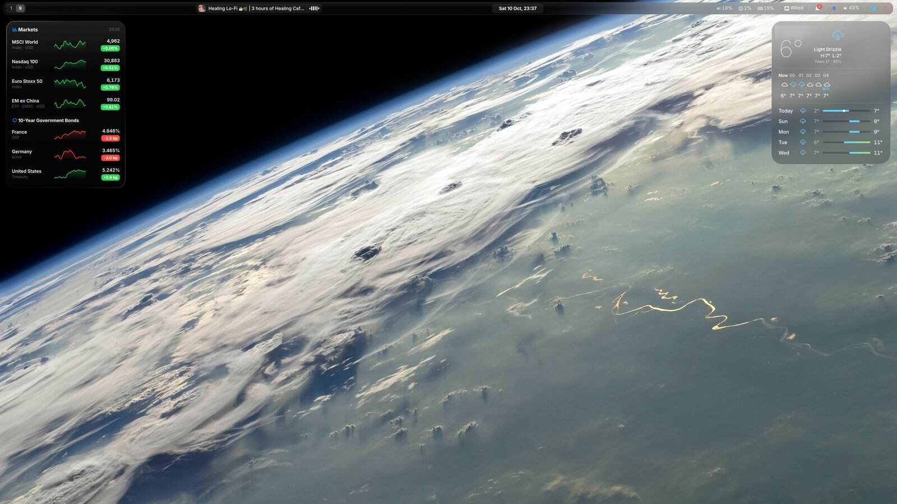
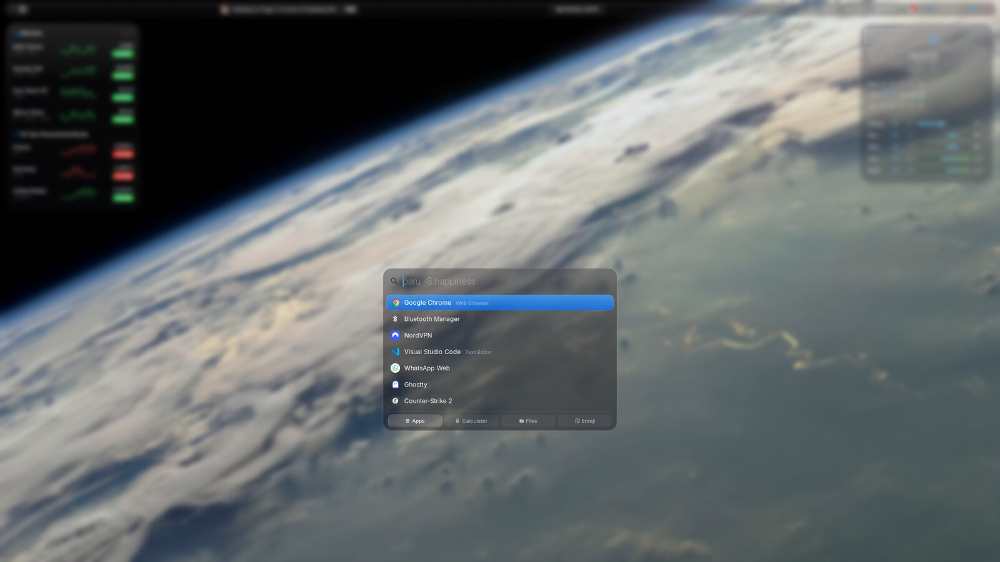
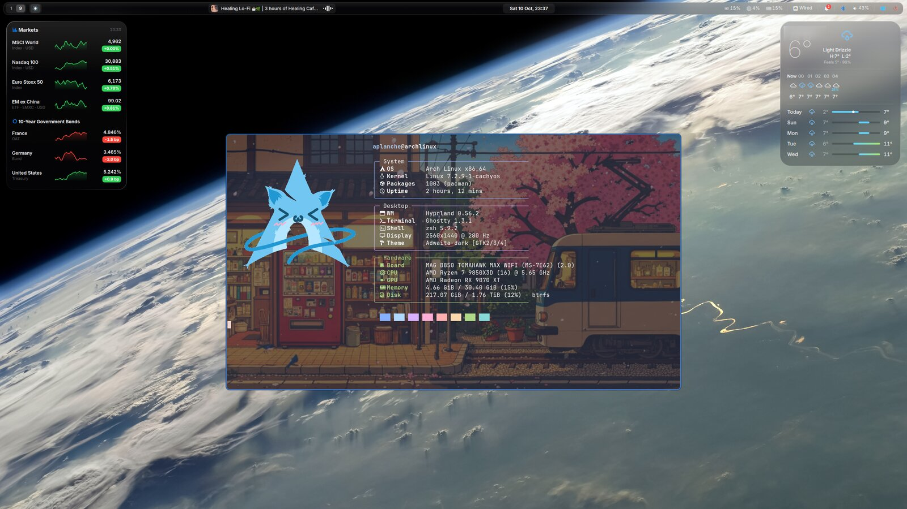

# ArchSetup

**From a blank SSD to my full Arch Linux desktop with one clone and one script.**
Boot the Arch USB, run the installer, log in, answer a few friendly dialogs, and the machine looks and
behaves exactly like the one it was copied from, with documents and pictures syncing back from the cloud.



## What you get

**A polished Hyprland desktop**
- **Quickshell bar** with liquid-glass popups: calendar (Google, through Evolution), Wi-Fi, Bluetooth,
  volume, notifications, media, CPU/GPU/RAM stats, a battery on laptops, and a one-click
  "Restart into Windows" when there is a dual boot.
- **Desktop widgets**: markets (indices and bond yields) and weather.
- **Spotlight-style launcher** (`Super+Space`): apps, calculator, files and emoji in one box.
- **Ghostty** terminal with a background image that rotates every 15 minutes, zsh + oh-my-zsh,
  fastfetch on the first terminal.
- **Rotating wallpapers**, a hyprlock lock screen, screen-off after 10 minutes, dark theme while an OLED
  monitor is plugged in (burn-in care) and an auto-hiding bar on it.
- **Liquid Glass login screen** (a custom SDDM theme) showing the latest Windows Spotlight photos.
- **macOS-style keys everywhere** (keyd): `Alt+←/→` start/end of line, `Ctrl+Shift+[ / ]` switch tabs.

<p align="center">
  
  
</p>

**A fast, secure base**
- **CachyOS kernel** (+ LTS fallback) and CachyOS packages optimized for the CPU (znver4 / v4 / v3, picked automatically),
  the `scx_lavd` gaming-friendly scheduler, zram.
- **Secure Boot with your own keys**: kernels are signed automatically on every update.
- **Quiet boot**: the motherboard logo with the Arch logo and a spinner, no text.
- **btrfs snapshots** of `/` and `/home` every hour (snapper).

**Smart about the hardware**: it installs only what the machine needs:
AMD, Intel or NVIDIA graphics (including the right legacy driver for older NVIDIA cards), hybrid laptops,
Bluetooth, Broadcom Wi-Fi, laptop battery and power profiles, virtual machine guest tools.
No Windows button and no NTFS tools if there is no Windows.

**Things that keep running on their own**
| Every | What |
|---|---|
| 5 minutes | `~/Documents` and `~/Pictures` sync both ways with Cloudflare R2 (newest copy wins) |
| day (weekly update) | full system + AUR update, Hyprland plugins rebuilt, desktop notification |
| 15 minutes | new terminal background |
| week | new Windows Spotlight photos for the login screen |

## Install on a new machine

### 1. Base system, from the Arch USB

```sh
iwctl                     # Wi-Fi only: station wlan0 connect "<network>"
pacman -Sy git
git clone https://github.com/<you>/ArchSetup
ArchSetup/live-install.sh
```

It asks which disk to use and whether you want **Windows next to Linux**:

- Linux only
- Windows on another SSD
- Windows on this SSD, to be installed later (space is set aside for it)
- Windows on this SSD, already installed (Linux goes into the free space)

…plus your user name, password, time zone and, optionally, disk encryption. Then reboot.

> Prefer `archinstall`? That works too: choose **systemd-boot** and keep the EFI partition on **/boot**,
> then clone the repo to `~/Workspace/ArchSetup` after the first boot.

### 2. The installer, at the first login

Log in on the console: `install.sh` starts by itself. You type your password once and pick the optional groups:

- **Gaming**: Steam and 32-bit graphics drivers
- **Local LLM**: llama.cpp server with a Qwen model (about 22 GB)
- **NordVPN**
- **Older apps**: waybar, hyprpanel, an older login theme

Everything else is automatic: repositories, kernels, drivers, about 100 packages (more with the optional groups), settings, scheduled jobs.
At the end it offers to reboot.

### 3. The setup wizard, in the desktop

After logging in, a checklist opens for the few things that need you. Accounts are signed in **in the
browser**, never typed into a terminal:

| Task | How |
|---|---|
| Secure Boot | Guided in 3 steps, with reboots into the firmware (BIOS) and hints for each brand. It tells you which step you're at, and what probably went wrong if a step didn't take. |
| Cloudflare R2 | A form for the access keys, which are checked before saving. Then Documents and Pictures start downloading. |
| pCloud, GitHub, NordVPN | Browser login |
| Google account | Added in Evolution, for the bar's calendar |
| Chrome, VS Code | Sign in to get bookmarks, extensions and settings back |
| Hyprland plugins | Built automatically (workspace overview on `Super+Tab`) |
| LLM model | Download with a progress bar |

Skip anything; it comes back at the next login. Reopen it any time with `arch-setup-wizard`
(`--all` to redo a step).

## Using it day to day

- **Your settings live in this repo.** `~/.config/hypr`, `~/.config/quickshell`, `~/.zshrc`, your scripts…
  are links into it, so editing them edits the repo. Commit and push; on another machine, `git pull`.
- **System files** (under `system/`, e.g. the login theme) are copied, not linked: edit them in the repo,
  then run `./install.sh system`.
- **Re-run anything**: every step can safely run again. `./install.sh` does everything,
  `./install.sh dotfiles system` only those steps, `./install.sh --reconfigure` asks the questions again.
- **Add a package** to the right list in `packages/`. **Track a new config file**: put it under `home/`
  at the same path, add the path to `links.txt`, run `./install.sh dotfiles`.

### Keyboard shortcuts

| Keys | Action |
|---|---|
| `Super+Space` | Launcher |
| `Super+T` / `Super+Enter` | Terminal |
| `Super+B` / `Super+C` / `Super+E` | Chrome / VS Code / Files |
| `Super+Q` | Close window |
| `Super+F` / `Super+A` / `Super+V` | Fullscreen / maximize / float |
| `Super+Tab` | Workspace overview |
| `Super+1…9`, `+Shift` to move a window | Workspaces |
| `Super+Z` | Show / pin the bar (auto-hidden on the OLED monitor) |
| `Super+Shift+S` / `Print` | Screenshot of an area / the screen, to the clipboard |

## What is *not* in the repo

- **Your files**: Documents and Pictures come back from R2, wallpapers included.
- **Secrets**: R2 keys, tokens and logins are entered in the wizard and stay on the machine.
- **Machine-specific bits**: monitor layout, GPU settings, the answers you gave the installer.
- **A few vendor tools** you install by hand if you still use them: kiro-cli, the Hermes agent, agy, cua-driver.

## Requirements

A 64-bit PC with **UEFI** (no legacy BIOS), an internet connection, and the Arch Linux USB.
Secure Boot is optional but supported on any firmware that lets you clear its keys.

---

Working on this repo with a coding agent? See [AGENTS.md](AGENTS.md).
